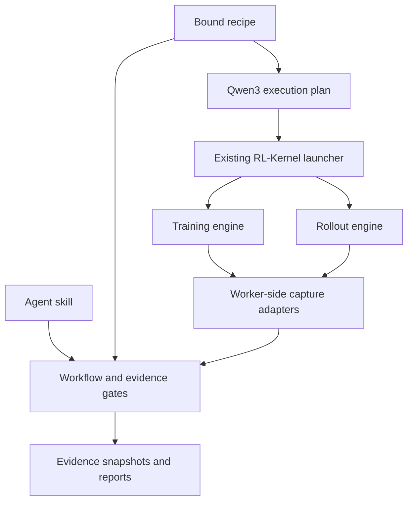

# Architecture

Worker-side capture adapters are an integration task in this release, not automatic instrumentation. They must observe actual loaded kernels, logical tokens and weight versions in the actual engine workers.

| Path | Responsibility |
|---|---|
| `skills/train-inference-consistency/` | Agent workflow, boundaries and debugging practice |
| `src/rl_consistency/contracts.py` | Bound model/environment/coverage contract |
| `src/rl_consistency/compare.py` | Raw-bit or independent-reference comparisons |
| `src/rl_consistency/gates.py` | Gate-specific machine checks |
| `src/rl_consistency/workflow.py` | Immutable recipes, evidence snapshots, invalidation and review records |
| `src/rl_consistency/adapters.py` | Model/engine protocols and Qwen3 launcher bridge |
| `src/rl_consistency/report.py` | Escaped, offline HTML |
| `src/rl_consistency/recipes/` | Packaged candidate recipes |
| `tests/` | Synthetic CPU regression tests; not numerical certification |

No RL-Kernel code is vendored. Reuse canonical `rl_engine/contracts`, `runtime`, `integrations`, `validation`, `models` and `distributed` APIs when adding engine capture. Keep new numerical implementations upstream in RL-Kernel.

## State and invalidation

A run snapshots one bound recipe and its hash. Each attempt snapshots its evidence and referenced JSON artifacts, hashes them, binds prerequisite attempt IDs, and records its machine verdict. Retrying a prerequisite changes its ID, invalidating descendants and reviews tied to old attempts. Modifying copied artifacts invalidates their attempt. Never repair snapshots in place.

`flock` serializes workflow writes on POSIX hosts; these operations target Linux accelerator environments and macOS developer machines. Do not share one run directory over storage whose locks are unreliable. Large tensor stores and distributed producer transport are future work.

The manifest/result hash scheme detects ordinary drift; it is not tamper-proof against a person who can rewrite the whole run. Local reviewer names are declarations. A future registry needs authenticated approval and artifact signing.

## Model extension

Implement a topology/operator inventory, a reduced-model builder preserving original dimensions and precision, and semantic boundaries for tracing. Implement worker-side engine capture and full-model/optimizer/checkpoint evidence production. Add real coverage cases and tests, then repeat C0–C10. Do not assume an empty adapter directory means support.

The first CLI deliberately accepts only the Qwen3/vime/vLLM/Megatron launch path. Cross-hardware, MoE router replay, PD separation and other frameworks need explicit adapter and contract work.
