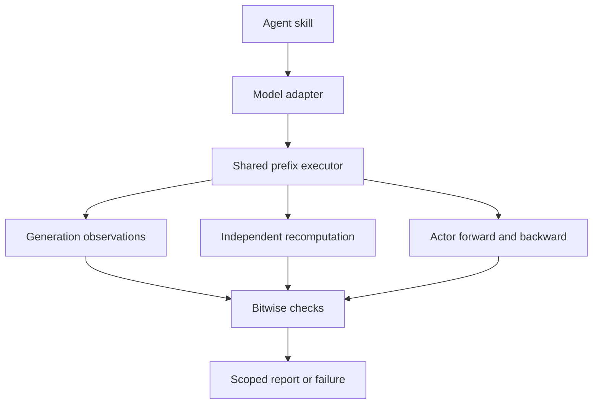

# Architecture

The default product is independent: an agent skill selects a model adapter and a shared trainable executor, then inspects measured parity. RL-Kernel is not required by this route.

`shared-prefix-v1` fixes physical batch size one, uses no cache, and recomputes each logical prefix through eager, grad-enabled provider code. Its intentionally narrow contract and performance costs are documented in [independent-runtime.md](independent-runtime.md). Model names do not grant acceptance; all three full-model GPU statuses remain pending.

| Path | Responsibility |
|---|---|
| `skills/train-inference-consistency/` | Select independent execution, native diagnosis or advanced verification |
| `src/rl_consistency/runtime/models.py` | Independent model registry, config checks, safetensors loading and provider identity |
| `src/rl_consistency/runtime/execution.py` | Shared generation/recompute/actor path, original-byte capture, state guards and mismatch handling |
| `src/rl_consistency/runtime/runner.py` | Fixture checks, actual calibration updates and retained reports |
| `src/rl_consistency/diagnostics/` | Native hooks, semantic DAG localization, binary snapshots, repeat checks, replay and HTML matrices |
| `src/rl_consistency/compare.py` | Formal trace comparisons and independent-reference tolerances |
| `src/rl_consistency/capture.py` | Worker identity and exact-coverage trace publication |
| `src/rl_consistency/contracts.py`, `gates.py`, `workflow.py` | Existing C0–C10 contracts, evidence validation, invalidation and review records |
| `src/rl_consistency/models/`, `model_setup.py` | Source-preserving proxy config preparation and model-specific formal gate requirements |
| `src/rl_consistency/adapters.py`, `rocm.py`, `rlk_import.py` | Optional legacy RL-Kernel launch and sidecar compatibility |
| `src/rl_consistency/recipes/` | Existing candidate vime recipes for the legacy engine workflow |
| `tests/test_runtime.py` | Real tiny provider architectures; no full-model certification |

## Separate result scopes

Runtime reports (`runtime-check.v1`), native diagnostics (`diagnostic-trace.v1`) and formal workflow evidence (`evidence.v2`) have different meanings. Runtime equality or native diagnostic matches cannot advance C0–C10. Existing vime recipes still bind their RL-Kernel and framework identities; the independent runtime does not consume those recipes or manufacture equivalents.

A formal workflow snapshots one bound recipe. Retrying prerequisite gates invalidates descendants and reviews tied to old attempts. Source/model/environment changes need fresh evidence. Reports and hashes detect ordinary drift, not malicious rewriting of an entire evidence set. Reviewer names are declarations, not authentication.

## Extension boundaries

For another model using covered operators, add its checkpoint/config adapter and architecture tests to the common executor. New stateful operations, quantization, distributed execution or engine routes need explicit numerical and capture work. Existing source-preserving proxies used for formal acceptance are distinct from tiny architecture tests used in CI.

The native [diagnostic matrix](diagnostics.md) can locate observed divergence before model registration. Explicit semantic mappings and actual engine hooks are still required; generic hooks do not infer fused internals. The shared runtime captures decoder layer hashes and actual MoE router outputs, which locate an observed boundary but do not prove the internal root cause.

A faster provider may later add invariant kernels, cache execution and sharding. It must retain the same stated comparison contract or declare a new scope, with actual model/environment validation. There is no automatic dependency on an external kernel project for implementing such providers here.
