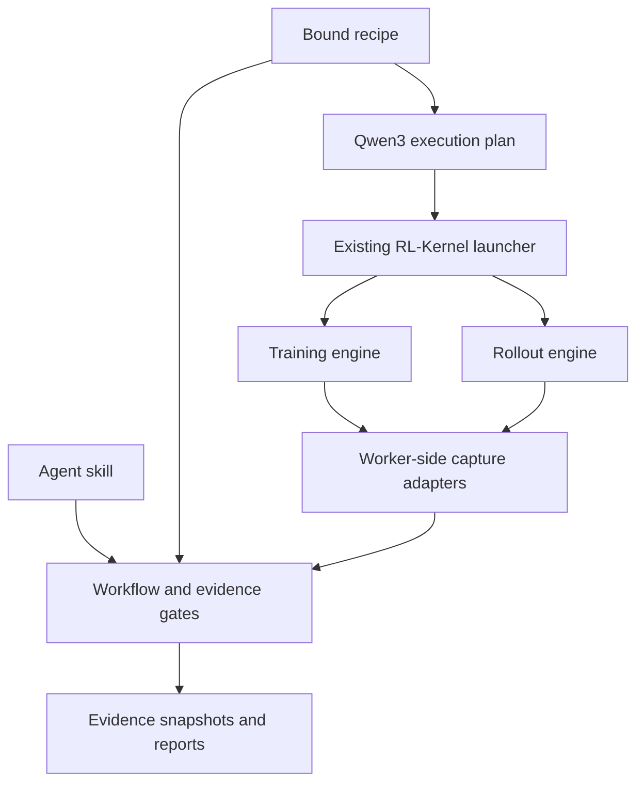

# Architecture

Worker-side capture adapters are an integration task in this release, not automatic instrumentation. They must observe actual loaded kernels, logical tokens and weight versions in the actual engine workers.

The explicit capture API and the historical sidecar diagnostic importer are
implemented; [capture.md](capture.md) describes their boundaries. Engine hook
installation, weight observation and distributed evidence assembly remain
adapter work.

| Path | Responsibility |
|---|---|
| `skills/train-inference-consistency/` | Agent workflow, boundaries and debugging practice |
| `src/rl_consistency/contracts.py` | Bound model/environment/coverage contract |
| `src/rl_consistency/compare.py` | Raw-bit or independent-reference comparisons |
| `src/rl_consistency/capture.py` | Worker provenance and exact-coverage trace publication |
| `src/rl_consistency/diagnostics/` | Native module inventory/hooks, bounded binary snapshots, semantic DAG localization, callable replay and comparison matrices |
| `src/rl_consistency/rlk_import.py` | Pinned Vime sidecar diagnostics, TP/CP checks; no gate promotion |
| `src/rl_consistency/rocm.py` | Fixed-policy ROCm launch, environment checks and raw sidecar reports |
| `src/rl_consistency/gates.py` | Gate-specific machine checks |
| `src/rl_consistency/workflow.py` | Immutable recipes, evidence snapshots, invalidation and review records |
| `src/rl_consistency/adapters.py` | Model/engine protocols and Qwen3 launcher bridge |
| `src/rl_consistency/models/qwen38.py` | Hybrid Dense config inventory, proxy specification and model-specific gate checks |
| `src/rl_consistency/models/gdn_reference.py` | CPU FP64 GDN core accuracy reference with autograd |
| `src/rl_consistency/model_setup.py` | Read-only inspection and new model preparation bundles; no GPU launcher |
| `src/rl_consistency/report.py` | Escaped, offline HTML |
| `src/rl_consistency/recipes/` | Packaged candidate recipes |
| `tests/` | Synthetic CPU regression tests; not numerical certification |

No RL-Kernel code is vendored. Reuse canonical `rl_engine/contracts`, `runtime`, `integrations`, `validation`, `models` and `distributed` APIs when adding engine capture. Keep new numerical implementations upstream in RL-Kernel.

## State and invalidation

A run snapshots one bound recipe and its hash. Each attempt snapshots its evidence and referenced JSON artifacts, hashes them, binds prerequisite attempt IDs, and records its machine verdict. Retrying a prerequisite changes its ID, invalidating descendants and reviews tied to old attempts. Modifying copied artifacts invalidates their attempt. Never repair snapshots in place.

`flock` serializes workflow writes on POSIX hosts; these operations target Linux accelerator environments and macOS developer machines. Do not share one run directory over storage whose locks are unreliable. Standalone diagnostics have a bounded, content-addressed binary tensor store; asynchronous large-model capture and distributed producer transport remain future work.

The manifest/result hash scheme detects ordinary drift; it is not tamper-proof against a person who can rewrite the whole run. Local reviewer names are declarations. A future registry needs authenticated approval and artifact signing.

## Model extension

Native diagnosis can precede model registration. See [diagnostics.md](diagnostics.md):
explicit semantic boundaries, independent repeats and a declared dependency graph
locate the earliest observed divergent frontier. `diagnostic-trace.v1` is a
separate format from formal `trace.v1`; diagnostic results never advance gates.
Generic hooks do not infer fused semantics or install themselves in engine workers.

Implement a topology/operator inventory, a reduced-model builder preserving original dimensions and precision, and semantic boundaries for tracing. Implement worker-side engine capture and full-model/optimizer/checkpoint evidence production. Add real coverage cases and tests, then repeat C0–C10. Do not assume an empty adapter directory means support.

GPU launch commands deliberately accept only the Qwen3-8B/vime/vLLM/Megatron path.
The second model, Qwen3.8-27B, has a working CPU preparation adapter with Hybrid
coverage requirements; its strict providers, engine capture and launch bridge
are pending. Cross-hardware, MoE router replay, PD separation and other frameworks
need explicit adapter and contract work.
