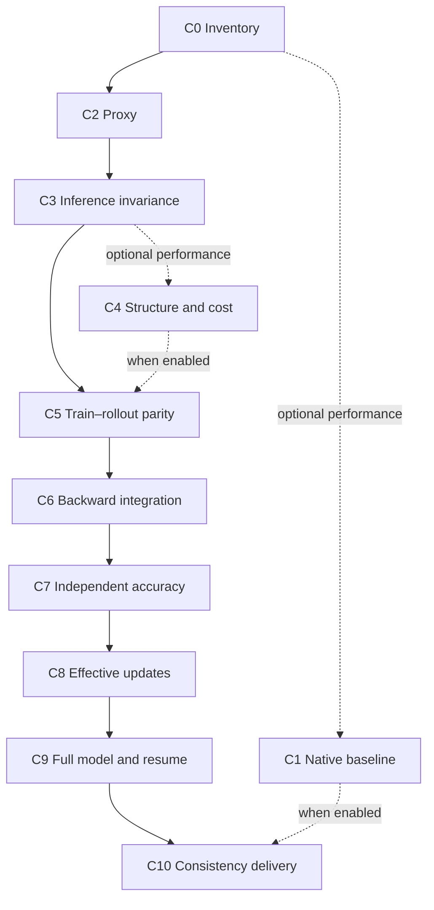

# Workflow, dependencies and resuming work

Use one task workspace per bound scope in the target project. Pin the model revision, complete weight manifest, tokenizer, input fixture, numerical contract, relevant source/build artifacts, loaded implementations, hardware and process groups. Keep immutable attempt directories beneath it. Markdown is the human index; use suitable machine-readable records and binary tensors in that workspace.

The [skill suite](skill-suite.md) separates coordination, diagnosis/verification and implementation/integration. Reuse this task workspace and its evidence history across roles. Role completion is not gate acceptance; a bounded investigation may finish with a failure or blocker while downstream gates remain unexecuted. An end-to-end implementation request authorizes routine iteration between the procedures; separate agents are not required.

## Acceptance mode and dependencies

Default to `consistency-only`: implement and verify the simplest valid path, with no speed target. Mark C1/C4 `not-required` with reason `performance not requested`. Slow implementations can be final deliveries; use [correctness-first.md](correctness-first.md). Memory/resource availability still matters to completing actual execution, without introducing a performance acceptance budget.

Select `consistency-and-performance` only when requested. Then require C1 after C0, C4 between C3/C5 and the enabled performance evidence at C10. Keep native tuning and consistency implementation in separate worktrees or equivalent isolated outputs. Share workload/identity requirements, not writable measurements. Use multiple agents only when authorized and useful; sequential execution works too.

Keep C0–C10 numbering and responsibilities. Early experiments are allowed, but do not label a dependent gate passed while its active prerequisites are missing. A local CPU check may pass while the canonical gate remains blocked on a representative proxy or real target execution; record both levels explicitly.

## Status and decisions

| Status | Meaning |
|---|---|
| not-started | No execution or implementation attempt yet |
| in-progress | Active work; no accepted result yet |
| pass | Required work and cases executed, evidence inspected, prerequisites valid |
| fail | An executed required check violated its criterion; preserve the failure |
| blocked | A named input, implementation, device, permission or required decision is missing |
| stale | A previously accepted result no longer binds the current implementation/scope |
| not-required | Only C1/C4 in consistency-only mode; performance was not requested, no pass claimed |

An unsupported required case is blocked or failed, never passed. Do not apply `not-required` to C0/C2/C3/C5/C6/C7/C8/C9/C10, required gradients/accuracy, updates, resume or full-model evidence. A genuinely inapplicable subcase needs an explicit model/scope reason; keep its exclusion visible and do not remove the parent gate. C5/C7/C8/C9 cannot be replaced with a smoke-test exemption. If the user only requests diagnosis or a development subset, report that subset without claiming C0–C10 completion.

Record actual precision/tolerance, full-model recipe and release decisions; baseline/performance decisions apply only when that track is enabled. Use existing explicit authorization; do not manufacture reviewer identities or require a new approval for every routine action. Continue independent authorized work while a necessary decision is pending. Release conclusions and any enabled baseline conclusions must identify who accepted the evidence under the target project's policy. Do not invent a performance approval for consistency-only work.

## Invalidation

Bind each accepted attempt to input/config/source/build hashes, loaded worker identity and the IDs of its prerequisites. A relevant change makes affected attempts stale. Repeated failures remain visible; they do not overwrite a prior success or vice versa. Never repair raw evidence in place.

- Numerical path, casts, reduction order or model mapping changes: revisit C0 and relevant C2–C9 cases.
- Performance/fusion/Graph changes: rerun impacted C3/C5/C7 and downstream full acceptance; repeat C4 and performance measurements only when that track is enabled; always revisit affected correctness evidence at C10.
- Proxy coverage changes: repeat C2 and affected proxy gates.
- Weights, tokenizer, objective, fixture, topology, hardware or provider changes: create a new bound run; reuse only artifacts demonstrably unaffected and explicitly justify reuse.
- Native baseline changes: create a new C1 baseline revision and repeat comparisons that use it. Never silently rewrite a frozen baseline. A performance-only baseline change does not by itself invalidate unchanged consistency-only evidence.

If performance is later requested, change the mode explicitly, activate C1/C4 and re-evaluate the added C5/C10 prerequisites. Retain earlier consistency evidence and reuse only unchanged artifacts; do not fabricate historical performance passes.

## Resume across agents

Before acting, read the task brief, latest run ledger, latest handoff and the raw records for the next prerequisite. Verify relevant working-tree changes and artifact hashes; do not trust `pass` text alone. Record which previous attempts remain valid. Follow the exact next action or explain why new evidence changes it.

A handoff must retain target repo/ref/dirty changes, actual commands, environment/weight identity, coverage gaps, the smallest failing sample, first observed frontier, blockers and next action. If no executable command exists yet, identify the file/function to implement next and mark execution pending. Never invent a command merely to fill a template.
